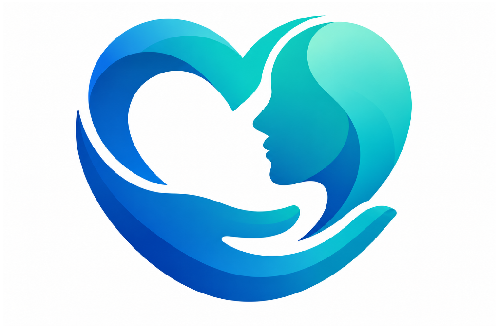
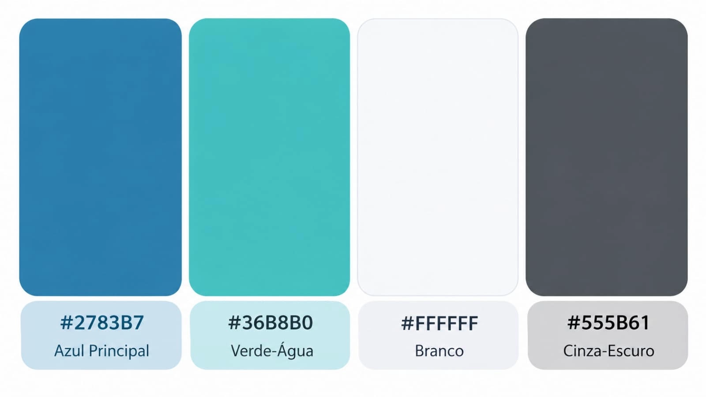

# AcolheMind 💙

> **Plataforma móvel de suporte imediato e telepsicologia para pais e cuidadores de crianças neurodivergentes**

[](https://sdgs.un.org/goals/goal3)
[](#)
[-brightgreen.svg)](#)

---

## 👥 Identificação do grupo e entrega acadêmica

* **Instituição:** Centro Universitário FMU (Escola TECH - Level UP)
* **Projeto Integrado:** FMU Tech Inovação — 1ª Edição 2026.2
* **Desafio:** ODS 3 da ONU — Saúde e Bem-Estar
* **Semestre:** 2º Semestre
* **Integrantes do Grupo:**
  * Rafaela Rodrigues de Andrade — RA: 2026103914 - @RafaelaRAndrade
  * Leticia Albuquerque Oliveira — RA: 2026108965 - @leticia-albuquerqu
  * Amanda Vitoria Borges Santos — RA: 2026102373 - @borgesamandaaa
  * Ana Julia dos Reis Sila — RA: 2026107910 -
  * Sarah dos Santos — RA: 2026111956 - @sarahsantos152007-prog

---

## 1. 📌 Descrição do Problema

### Título do Projeto
**AcolheMind: Suporte imediato e telepsicologia para cuidadores de crianças neurodivergentes**

### O Problema de Saúde e Bem-Estar (ODS 3)
O recebimento do diagnóstico atípico em crianças (como Transtorno do Espectro Autista - TEA, TDAH e síndromes do neurodesenvolvimento) desencadeia uma grave crise invisível de saúde mental na unidade familiar. A ausência de suporte estruturado gera quatro dores centrais:

1. **Insegurança e desorientação inicial:** pais de primeira viagem enfrentam isolamento, escassez de orientações claras e falta de direcionamento prático nos primeiros passos pós-diagnóstico.
2. **Gestão desafiadora de crises:** elevada dificuldade técnica e estresse emocional para manejar episódios de desregulação infantil (surtos comportamentais e sobrecargas sensoriais) no dia a dia.
3. **Exaustão e burnout parental:** níveis severos de estresse, ansiedade e depressão vivenciados por cuidadores principais devido à sobrecarga física e falta de rede de apoio.
4. **Barreira de acesso a especialistas:** complexidade, tempo em longas filas de espera e custos elevados para agendar atendimentos com profissionais de saúde mental infantil.

### Público e contexto afetado
* **Público-alvo:** pais, mães e cuidadores de primeira viagem de crianças neurodivergentes (de 0 a 12 anos).
* **Contexto:** domicílios urbanos, famílias atendidas pelo SUS em fila de espera para neuropediatria/psicologia e beneficiários de convênios/planos de saúde corporativos que necessitam de acolhimento contínuo e autorregulação guiada em momentos de crise.

### Bases de Dados Públicas e Reais Utilizadas
Para garantir fundamentação estatística e epidemiológica real ao problema, a solução utiliza as seguintes bases abertas:

| Base de Dados Pública | Órgão / Origem | Aplicação Prática no Projeto |
| :--- | :--- | :--- |
| **DATASUS / TABNET (SIH/SIA)** | Ministério da Saúde | Dimensionamento da prevalência de diagnósticos de transtornos do desenvolvimento e volume de atendimentos em neuropediatria/psicologia no SUS. |
| **Boletins VIVA / Sinan** | Vigilância Epidemiológica | Mapeamento de episódios de urgência, sobrecarga e ocorrências de saúde mental ligadas a crises comportamentais. |
| **PNAD Contínua** | IBGE | Análise socioeconômica de arranjos familiares, carga de trabalho não paga e níveis de estresse de cuidadores no Brasil. |
| **CNES (Cadastro Nacional)** | Ministério da Saúde | Mapeamento da distribuição geográfica de estabelecimentos de saúde mental e profissionais credenciados. |

---

## 💡 Proposta de Solução Tecnológica

### Como a Solução Ataca o Problema
O **AcolheMind** é uma plataforma móvel e PWA (Progressive Web App) focada em **UX de baixo esforço cognitivo sob estresse (*Low-Cognitive Load UX*)**. O ecossistema cobre 4 momentos da vida do cuidador:

* **Momentos de crise (Guia SOS Anticrise):** em poucos toques, o cuidador seleciona o comportamento observado e recebe instruções visuais e táteis de autorregulação e descompressão, com funcionamento *Off-line First* (mesmo sem internet).
* **O dia a dia (Diário de Gatilhos & Conteúdos):** mapeamento simplificado de rotina, alimentação e eventos antecedentes, gerando relatórios úteis para consultas médicas, além de trilhas curtas de orientação após o cadastro do perfil da família.
* **O cuidado com quem Cuida (Apoio ao Cuidador):** Check-in de bem-estar da saúde mental do responsável, pausa guiada pós-crise e acesso a grupos de apoio mediados.
* **Acompanhamento profissional (Telepsicologia):** Plataforma para agendamento e realização de consultas remotas com psicólogos credenciados (com modalidades para a criança/família e para o próprio cuidador), integrada a planos corporativos e convênios.

### Matriz de Mapeamento: Problema vs. Solução

| Problema Mapeado | Funcionalidade da Solução | Como Resolve |
| :--- | :--- | :--- |
| **Desorientação inicial** | Perfil da família + Conteúdos educativos | Trilhas curtas de orientação personalizadas conforme o diagnóstico e a idade da criança após o cadastro. |
| **Gestão de crises** | Guia SOS Anticrise | Passos visuais imediatos de acolhimento e autorregulação acionáveis em poucos toques, com funcionamento *off-line*. |
| **Exaustão parental** | Check-in de bem-estar, Pausa pós-crise e Grupos de apoio | Acompanha a saúde mental do próprio cuidador, oferece acolhimento pós-crise e reduz o risco de *burnout*. |
| **Acesso limitado** | Telepsicologia Especializada | Agendamento remoto com psicólogos para a criança/família e para o cuidador, integrado a convênios e planos corporativos. |

### Tecnologias Implementadas
* **Prototipagem & UI/UX:** Figma (mapeamento de jornadas, arquitetura de informação e protótipo interativo).
* **Front-end Web / Mobile:** HTML / JavaScript / React.js / Next.js ou Flutter (Interface responsiva mobile-first, com suporte a PWA e Service Workers para acesso off-line).
* **Back-end & APIs:** Node.js (Express) ou Python (FastAPI) para construção de APIs RESTful leves.
* **Banco de Dados & Autenticação:** Firebase (Firestore & Auth) ou Supabase (Banco NoSQL/Relacional em nuvem com criptografia nativa).
* **Telemedicina / Vídeo:** WebRTC / Daily.co API (Conexões peer-to-peer criptografadas para teleconsultas via navegador/app).

### Justificativa das Escolhas Técnicas
1. **PWA / Responsividade Web (Mobile-First):** Elimina a barreira de ter que baixar um aplicativo pesado da loja durante um momento de crise comportamental da criança. O acesso ocorre via link imediato ou atalho na tela inicial.
2. **Estratégia Off-line First (Service Workers):** Garante que as instruções do Guia SOS fiquem armazenadas em cache no dispositivo e funcionem perfeitamente em locais sem sinal de internet.
3. **Criptografia AES-256 e TLS 1.3:** Imprescindíveis para assegurar total conformidade com a LGPD e o código de ética do Conselho Federal de Psicologia (CFP) na proteção de dados sensíveis de saúde infantil.
4. **Viabilidade Acadêmica (2º Semestre):** Tecnologias de rápida curva de aprendizado que permitem focar na qualidade conceitual, na modelagem do banco e na prototipagem funcional exigidas para o nível atual do grupo.

---

## 3. 🎨 Identidade Visual Inicial

### Logotipo Conceitual
O logo do **AcolheMind** combina o símbolo de um cérebro/mente estilizado envolvido por traços orgânicos em formato de abraço/mãos de acolhimento, transmitindo suporte técnico alinhado com empatia humana.



### Tipografia
Poppins para títulos
Inter para textos e descrições

### Paleta de Cores Definição e Aplicação
A paleta foi desenhada focando em acalmar a vista em momentos de estresse, utilizando o azul como cor base e tons funcionais de alto contraste para a usabilidade do aplicativo:



```text
========================================================================================
COR                     HEX       APLICAÇÃO E HIERARQUIA DE UI/UX
========================================================================================
[ Azul Principal ]     #2783B7   -> Títulos, tipografia principal e estrutura visual
[ Verde-água ]         #36B8B0   -> Elementos primários de marca, botões e navegação
[ Branco ]             #FFFFFF   -> Fundo de cards e superfíces
[ Cinza-escuro ]       #555B61   -> Subtítulos, legendas, datas e metadados.
========================================================================================
